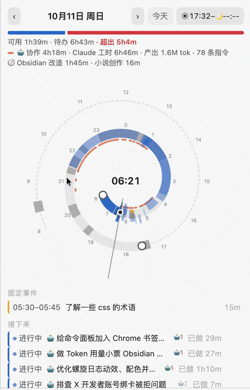
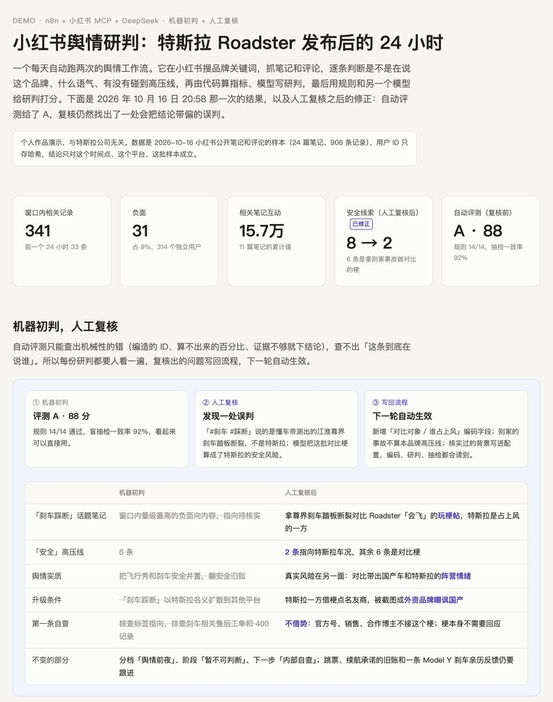

  

<table align="center">
  <tr>
    <td align="center"></td>
    <td align="center"></td>
    <td align="center"></td>
  </tr>
  <tr>
    <td align="center">🧾 Token 小票</td>
    <td align="center">🌀 螺旋日程</td>
    <td align="center">💬 Telegram Companion</td>
  </tr>
</table>

🌀 <a href="https://github.com/MatsuriMW/nautilus-spiral">螺旋日程</a> · 50 秒介绍片（有声音）：片子里的面板是插件自己的代码按一篇虚构日记画出来的

https://github.com/user-attachments/assets/1e0967bc-d498-456a-9d82-46750d761c08

🌀 螺旋日程 · 日记里每一行 DOING 下面，实时显示它绑着的 Agent 会话在跑还是在等你、最近一步、用了多少 token，派出去的 subagent 和开着的 side chat 也在这里

  

## 这些项目拼在一起

想做成的是「文件系统 + Agent」：主库就是一个 Markdown 文件夹，用 Git 管版本；Claude、Pi、Codex、WorkBuddy 读写的是同一个库。工作记录一半由人主动写，一半由 AI 自动记进日记；同一份日记既是陪伴 Agent 回话前读的上下文，也是个人的任务管理。下面的插件和 Skill 都是从这套东西里拆出来的零件。

## 可以直接拿去用的

| 项目 | 它做什么 | 现在的状态 |
|---|---|---|
| 🌀 [螺旋日程](https://github.com/MatsuriMW/nautilus-spiral) | Obsidian 插件。把今天日记里的事件和待办画成一条螺旋，待办从「现在」往后填进空档，容量条告诉你今天排不排得下；Claude、Codex、WorkBuddy 的会话可以自动记回日记，变成 DOING / SUSPENDED 的任务行和实际时段，任务行下面看得到会话在跑还是在等你、做到了哪一步 | 已上架 Obsidian 社区插件市场，Release 1.7.0，仅桌面端，macOS 上功能最全 |
| 🧾 [Token 小票](https://github.com/MatsuriMW/token-receipt) | Obsidian 插件。把一天里 Claude Code、Codex、WorkBuddy 用掉的 token 打成一张购物小票：按模型列出 token 和按 API 标价折算的金额，还有订阅额度用了多少。小票会从热敏打印机里走出来，也能落在木桌、钉上软木板，可以存成图片或会动的 SVG | 已上架 Obsidian 社区插件市场，Release 1.3.1，仅桌面端 |
| 💬 [Telegram Companion](https://github.com/MatsuriMW/telegram-companion) | Obsidian 插件。手机上随手发一句进当天日记；想聊的时候，它先读你近一周的日记再开口。模型自己选，接本机 Ollama 的话日记不出电脑 | 已上架 Obsidian 社区插件市场，Release 1.0.5，GPL-3.0，基于 Telegram Inbox |
| 🔗 [Roam Backlinks](https://github.com/MatsuriMW/roam-backlinks) | Obsidian 插件。像 Logseq、Roam Research 那样在反链里逐块原地编辑，带可展开的面包屑和带反链的 PDF 导出 | 已上架 Obsidian 社区插件市场，Release 1.0.1 |
| 🎭 [AI 人物设计 Skill](https://github.com/MatsuriMW/ai-character-design-skill) | 把「轻佻的男性」这种模糊感觉，拆成生图、生视频模型能直接执行的锁定段。附 122 张人物原型卡、服化道和连戏表 | v0.1.3，适用于 Claude Code / Codex / claude.ai |
| 🖼 [角色设定板 + 古典式配图](https://github.com/MatsuriMW/aigc-skills-and-agents) | 两个 Claude Skill：锁定角色长相的三视图和表情板 prompt；版画质感的 SVG 解释图 | 可用 |
| 🧰 [Obsidian-Plugins](https://github.com/MatsuriMW/Obsidian-Plugins) | 我自用的全部 Obsidian 插件：本地混合检索的「第二大脑」、LLM Wiki、稿件台、任务归位等。README 里按「装上就能用 / 要配合一套写法 / 适合参考着改」标了推荐度 | 持续更新 |
| ✍️ [skills-agents-and-prompts](https://github.com/MatsuriMW/skills-agents-and-prompts) | 写稿流水线、带出处的笔记问答、投资调研 Agent、「按感觉找图」等 Skill、Agent 和提示词 | 持续更新 |

## 正在做的

- **第二大脑的检索**：Obsidian-Plugins 里那个本地混合检索（向量 + BM25）。给它建了 48 道题的评测集和 16 道不参与调参的留出题，按 bad case 调了拒答门槛和切块：首条命中 70% → 80%，MRR 0.809 → 0.872，库里没有答案的问题从一道都挡不住到 8 道全部拒答。下一步加按日期和文件夹过滤。
- **[小红书舆情研判工作流](https://github.com/MatsuriMW/xhs-yuqing)**：n8n 定时调小红书 MCP 抓品牌相关的笔记和评论，DeepSeek 逐条编码（说的是不是这个品牌、情感、语气、高压线、动员级别、在拿谁做对比），指标由代码算，模型写研判，再用代码规则和另一个模型给研判打分。自动评测之后留一道人工复核，复核出的误判写回配置和编码规则，下一轮自动生效。[Demo](https://matsuri.site/demo/xhs-yuqing/)：特斯拉 Roadster 发布后 24 小时的研判，含人工复核前后的对照。

  

